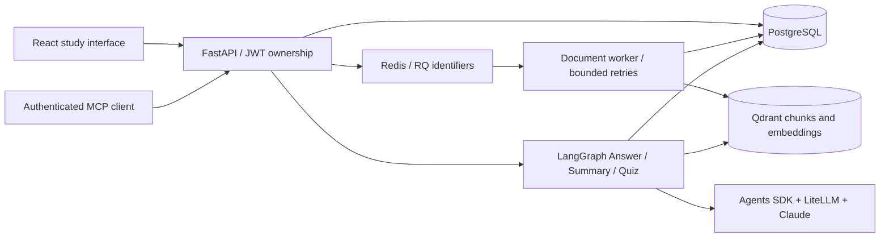

# Study Mate architecture

Study Mate is a modular Python application with separate API and worker processes,
a React/TypeScript client, and PostgreSQL, Qdrant, and Redis services. Workspaces
and preference/provider controls in the UI remain excluded by product decision.

## Storage boundaries

- PostgreSQL: users, auth sessions, original PDFs, original validated study images,
  document status/hash/job ID, conversations, evidence snapshots, quiz references,
  attempts, revisions, preferences, and LangGraph checkpoints.
- Qdrant: extracted chunks, embeddings, and page/document/owner metadata. Only ready,
  owned documents are eligible for retrieval. Changing the chat provider does not
  regenerate embeddings.
- Redis: durable queue state and RQ retry scheduling. Jobs contain only identifiers;
  neither PDF content nor model secrets are serialized into job arguments.
- Browser: tab-scoped JWT and quiz drafts. PDF/image previews are authenticated blob
  downloads with temporary object URLs, revoked on cleanup. No uploaded originals
  are written into the repository.

## Ingestion reliability

The API validates a text PDF and its limits, acquires a per-owner/content-hash
PostgreSQL advisory lock, and saves its original bytes. It commits a queued
record with a fresh job ID before enqueueing, then returns 202. A worker loads the
original from PostgreSQL, waits for the upload lock to release, marks processing,
splits/extracts pages, and upserts stable Qdrant chunk identities. Only after
indexing succeeds does the document become ready.

Jobs have a 900-second default timeout and two retries at 10 and 30 seconds.
Retries delete incomplete vectors before rebuilding; duplicate ready uploads
reuse the original record. A duplicate queued upload reuses an active job. New
job generations supersede stale jobs, which cannot overwrite a newer result.
Failures and worker timeouts update public status without exposing exception
details. Manual retry can recover failed jobs and queued records whose job was
lost before enqueue. This is recoverable delivery, not an atomic database/Redis
transaction: a crash between commit and enqueue requires that retry.

## Conversations and evidence

Each submitted text question has a request UUID; graph threads are scoped to
owner and request. Message commits use a conversation version check and a
request/role uniqueness constraint. The saved assistant message stores source
excerpts/page references and a quiz ID independently of workflow checkpoints.
Reopening history restores evidence, quizzes, and image attachments. Older
messages can use retained checkpoint evidence and deterministic quiz IDs.
Snapshots are evidence, not proof that an answer is factually entailed: review
representative real PDFs before release.

Image questions use Claude vision and are explicitly grounded in the image.
The question, validated image bytes, and answer persist in PostgreSQL. Retrieval
of an image first checks ownership of its conversation. Images are not silently
converted into PDF evidence or searchable document chunks.

## Voice

Browser speech recognition fills a reviewable text draft. Sending enters the same
authenticated chat flow; browser speech synthesis reads answers aloud. No OpenAI
key is needed for this path. Recognition support varies and may involve the
browser provider's servers. Optional server audio-file transcription/speech
endpoints still require their configured provider. Voice is turn-based, not a
continuous realtime audio model.

## Serving and checks

Local Vite proxies `/api` to the API. The optional Compose web profile builds
React and uses Nginx to serve it and proxy API requests. Both listeners bind to
loopback by default. CI runs frontend tests/build/formatting and backend tests
against isolated PostgreSQL schemas, with external model calls mocked.
MCP verification includes a real client over loopback HTTP and real JWT/session
revocation checks; retrieval is mocked in that integration test. Separate live
provider and MCP smoke-test commands are available under `backend/evaluation/`.
